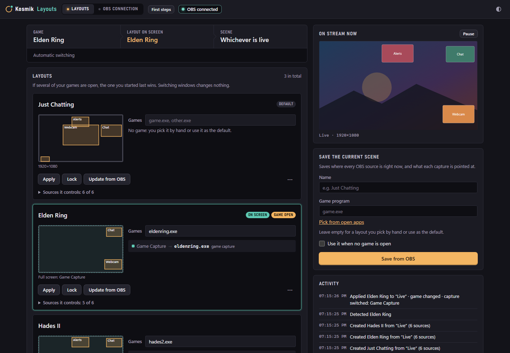

# Kosmik Layouts

**Your OBS scene rearranges itself for each game you play.**

Keep one live scene in OBS. When you open a game, Kosmik Layouts moves your camera, chat, alerts and the rest to where you placed them for that game, and points your game capture at it. Close the game and it goes back to your "just chatting" layout. No scene switching, no hotkeys, and no copying the same scene for every game.



- **You arrange things in OBS, as usual.** The app simply remembers each arrangement as a layout.
- **Each game can capture its own way.** One game on Game Capture, another on Window Capture: the right one turns on and points at the right game.
- **Background games don't get in the way.** If an idle game is open, the game you started last wins, and alt-tabbing changes nothing.
- **Smooth moves.** Sources slide into place (or snap, if you prefer).
- **Manual control when you want it.** Show a layout once, or lock one on screen whatever you're playing.
- **Safe.** It never creates, deletes or renames anything in OBS.

The page is in Spanish or English and comes in three looks (Studio, Daylight, Pixel), shared with [Kosmik Voice](https://github.com/kosmik-code/kosmik-voice).

## What you need

- Windows.
- OBS 28 or newer.
- [Node.js](https://nodejs.org/) 22 or newer (the LTS download is fine).

## Install

Download the [latest release](https://github.com/kosmik-code/kosmik-layouts/releases/latest) (**Source code (zip)** under *Assets*) and unzip it, or `git clone https://github.com/kosmik-code/kosmik-layouts`. Open a terminal in its folder and run:

```powershell
npm install
npm start
```

Then open **<http://127.0.0.1:7430/>**. Keep that terminal open while you stream.

## Set it up

1. **Let it talk to OBS.** In OBS, open **Tools › WebSocket Server Settings** and tick **Enable WebSocket server**. That's all: the app finds the port and password by itself. The pill at the top turns green when it's connected; if it doesn't, the page tells you why.
2. **Your no-game layout.** Arrange your scene in OBS for when you're not playing. On the page, under **Save the current scene**, give it a name (say, *Just Chatting*), tick **Use it when no game is open** and press **Save from OBS**.
3. **A layout per game.** Open the game and arrange the scene for it. If you use a Game Capture or Window Capture, point it at the game. Press **Pick from open apps** to choose the game, then **Save from OBS**.

Now close the game and open it again: the scene follows. The **First steps** button at the top shows these steps whenever you want them.

## Good to know

- **Changing a layout:** arrange it again in OBS and press **Update from OBS** on that layout.
- **Leave a source alone:** open *Sources it controls* on a layout and untick it (your alerts, say), and that layout won't touch it.
- **Renamed a source in OBS?** Layouts find sources by name, so press **Update from OBS** on the layouts that use it.
- **Anything you move by hand stays** until the next game opens or closes.
- **Kosmik Voice too:** set its overlay's *Placement* to **Free box** and it becomes a normal source you can drag and resize, so each layout can put your voice overlay somewhere else.
- **Which scene it controls:** whichever one is live, unless you pick one under **OBS connection › Behaviour**. There you can also set how long the slide animation lasts (0 = instant).
- **Two-PC setups:** in **OBS connection**, choose *Manual* and type the streaming PC's address and the password from OBS's *Show Connect Info*. Run Kosmik Layouts on the gaming PC, since that's where it looks for games.

## Status

This is an early version that does one thing well. There's no drag-and-drop editor yet: you arrange things in OBS itself. Ideas for later: dragging sources on the live picture, Twitch category as a trigger, vertical canvases (Aitum Vertical), nested scenes and groups, and a tray icon instead of a terminal.

---

## Technical details

### How it works

- **Layouts are snapshots.** Saving stores, for every source in the scene, its position, size, rotation, crop, bounds and whether it's visible. A layout only touches the sources it lists; unticked ones are skipped, and sources that are no longer in the scene are reported in *Activity*.
- **Capture targets.** For Game Capture, Window Capture and Application Audio Capture sources, a layout also stores what they capture: the mode (a specific window or any fullscreen app) and the window. Targets are matched by program (`window_priority` = executable), not just by window title or class, so another game built on the same engine (two Unity games, say) is never grabbed by mistake. A capture is only re-pointed when its target really differs and only if that layout shows it, because Window Capture restarts on every settings change. Captures are re-pointed before anything slides in, so a source never appears showing the previous game.
- **Game detection.** Every 3 seconds the app reads the Windows process list. If several programs with a layout are running, the one started last wins; programs already open when the app starts count as equally old, and then the layout listed first wins. No game means the default layout.
- **Switching.** It only acts when the wanted layout changes: a game starts or closes, you lock or unlock, or OBS reconnects. Moves are animated (400 ms by default) and a newer switch cancels an older animation.
- **OBS restarts.** While OBS is starting it answers "not ready"; the app waits and retries instead of failing, and re-applies once OBS is back.

### Connecting to OBS

- **Automatic** (default): the WebSocket port and password are read from OBS's own settings on this PC (`%APPDATA%\obs-studio\plugin_config\obs-websocket\config.json`), and re-read every few seconds, so a changed port or password (or the server just being switched on) is picked up by itself.
- **Manual**: host, port and password typed under *OBS connection*. *Save and connect* reconnects right away and says whether it worked (connected, wrong password, or nobody answering). Saved in `data/obs-connection.json`. The password never reaches the browser: the page only shows whether one is saved, and leaving the field empty keeps it.
- `KL_OBS_URL=ws://127.0.0.1:4455` and `KL_OBS_PASSWORD=...` override both (the page then shows the connection as fixed).

### Data and options

Layouts are stored in `data/profiles.json`, validated before every write and written atomically. A file that fails validation is moved aside as `profiles.broken-<time>.json`. Each layout keeps the size of every source, which the drawing on its card uses; layouts saved by older versions use the sizes OBS reports while connected (press **Update from OBS** once to store them).

Environment variables: `KL_PORT` (default `7430`), `KL_DATA_DIR` (default `./data`), `KL_OBS_URL`, `KL_OBS_PASSWORD`. The page accepts `?look=studio|daylight|pixel`.

### Security

- The page listens on `127.0.0.1` only, refuses foreign `Host` headers (DNS rebinding) and refuses changes without a same-origin `Origin` header, so other websites can neither read it nor drive it.
- The only connection it makes is to OBS: on your own PC, or at the address you typed.

### Development

```powershell
npm test
```

The tests run against an in-process fake OBS that speaks the real obs-websocket v5 protocol, password authentication included.

| Path | Role |
|---|---|
| `src/obs.js` | obs-websocket v5 client: auth, requests, reconnects; reads OBS's own settings |
| `src/connection.js` | Where OBS is: automatic, manual or environment |
| `src/games.js` | Process list, start order and which layout a game wants |
| `src/layout.js` | Capturing and applying layouts, capture targets, animation |
| `src/controller.js` | Decides what to apply and when; activity log |
| `src/store.js` | `data/profiles.json` schema, validation and atomic writes |
| `src/server.js` | Control page and JSON API with its guards |
| `public/` | Control page (`kosmik-ui.*` is shared with Kosmik Voice; keep both copies identical) |

## License

[MIT](LICENSE)
